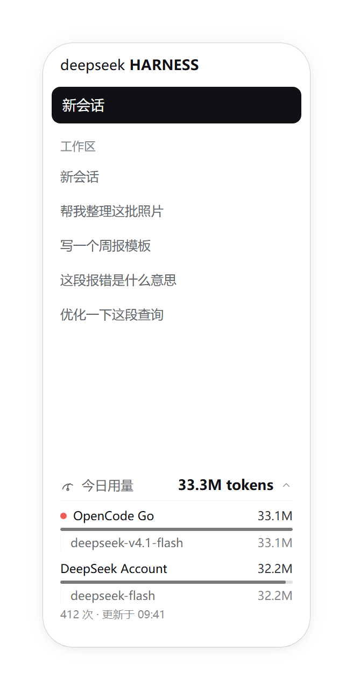
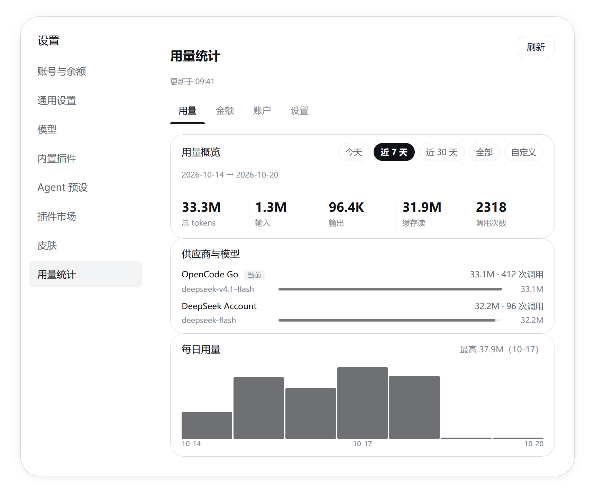
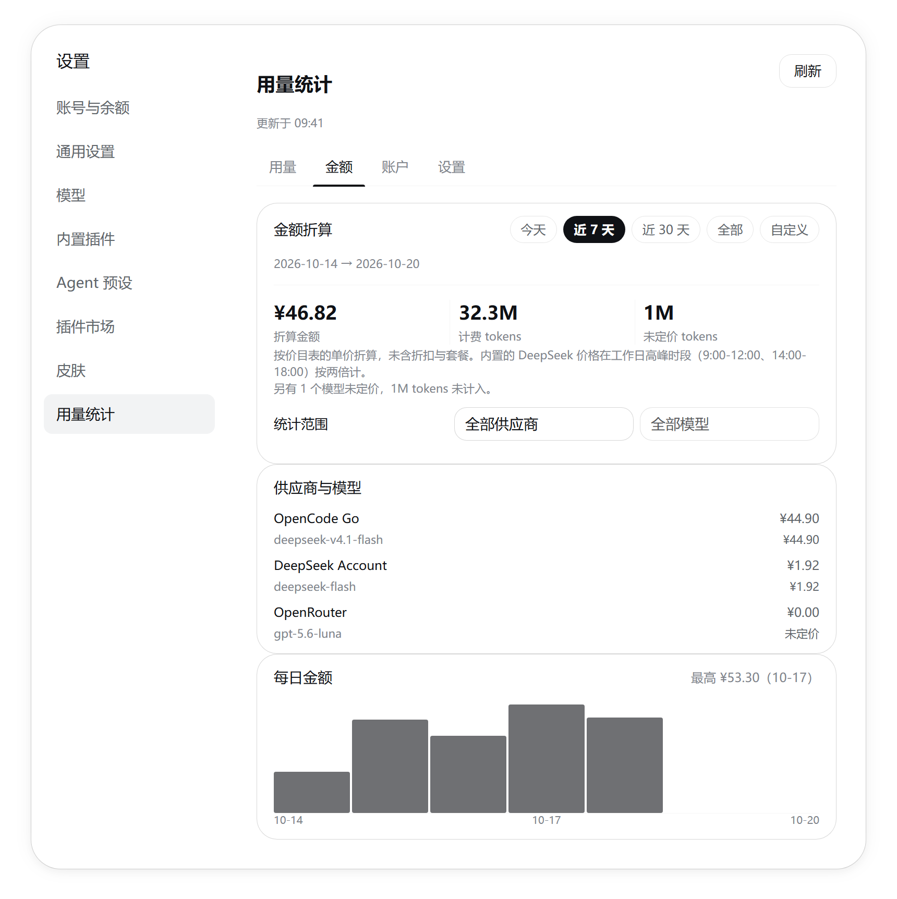
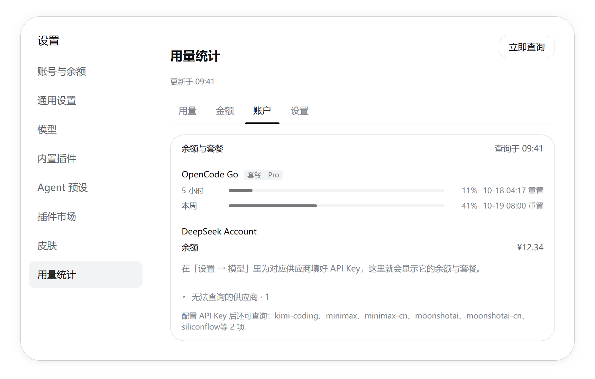

# dsh-abacus（算盘） · DeepSeek Harness (DSH) 用量台账、账户余额与套餐监控插件

[English](README.en.md) | 中文

<p align="center">
  
  &nbsp;
  
  &nbsp;
  
</p>

<p align="center">
  <strong>给 DSH Web GUI 与桌面客户端的 Token 用量台账、账户余额与编程套餐监控</strong><br>
  <em>侧边栏用量卡 · 本次对话明细 · 时间范围驱动的用量页 · 余额与套餐 · 余量提醒 · 历史补录</em>
</p>

它把每一次模型调用的 token 用量记成一份按「本地日期 / 供应商 / 模型」分桶的账本，再把同一份数据放在三个地方显示：侧边栏左下角的用量卡、输入框下方那枚「本次对话」胶囊、设置里的「用量统计」页。除了用量，它还会查询供应商的账户余额与编程套餐剩余额度，并在余量偏低时标出提醒。

数据只有两个来源：DSH 自己的会话事件（用量）和供应商自己的接口（余额与套餐）。余额与套餐**不做任何本地估算** —— 查不到就写明原因，不猜一个数字出来。

> **为什么叫「算盘」**：账本本来就是一颗一颗珠子拨出来的累计数。而在一堆 `dsh-usage`、`dsh-usage-stat`、`dsh-token-*` 之间，「算盘」不会认错 —— 这个插件 2.0.0 之前叫 `dsh-usage-stat`，[迁移方法见下](#从-dsh-usage-stat-迁移)。

## 界面

> 下面是 `tools/preview.mjs` 用**插件自己的组件**渲染出来的截图，不是应用截图：把样式表逐字注入，套在一个设置对话框外壳的替身里，颜色取自正在运行的 DSH 主题变量。主题色跟随皮肤变化，这里是原生主题。

| 位置 | 形态 |
|---|---|
| 侧边栏左下角 | 折叠时一行「今日用量 + 总量」，点开列出各供应商与模型；余量偏低时在对应供应商前点一个红点 |
| 输入框下方 | 一枚「本次对话 N tokens」胶囊，点开是这段对话自己的分供应商、分模型明细 |
| 设置 → 用量统计 | 四个标签页：用量、金额、账户、设置 |

<p align="center">
  <a href="preview/foot.png"></a>
  &nbsp;&nbsp;
  <a href="preview/usage.png"></a>
  &nbsp;&nbsp;
  <a href="preview/cost.png"></a>
  &nbsp;&nbsp;
  <a href="preview/account.png"></a>
</p>

<p align="center"><sub>点开可看原尺寸</sub></p>

## 功能

- **用量页**：一排等宽分栏的合计（总 tokens / 输入 / 输出 / 缓存读 / 调用次数，缓存写只在窗口内真的出现过时才占一格）、按供应商与模型的明细、以及覆盖整个所选窗口的每日柱状图。顶部可切换统计范围：今天、近 7 天、近 30 天、全部，或自选起止日期。所有卡片都跟随所选范围，供应商占比条全页共用一个刻度。
- **账户页**：每个供应商的账户余额与套餐窗口合在一处 —— 余额按币种显示，套餐显示 5 小时 / 本周 / 本月窗口的已用百分比与重置时间。查不到数据的供应商折叠在卡片最下面，并写明原因（未配置 API Key、已用账号登录、非官方地址、该供应商没有提供这项数据）。
- **金额页**：把所选窗口的 token 按价目表折算成金额，范围可以选全部、某个供应商、或某个供应商下的某个模型；单日窗口还会按小时折算。没有价格的模型不会被算成 0，而是单独列出来告诉你有多少 token 没计入。
- **设置页**：用量刷新间隔、账户查询开关与间隔、余量提醒阈值、价目表，以及底部的版本号与历史补录状态。
- **余量提醒**：给余额和三个套餐窗口各设一个阈值，低于阈值时在对应供应商旁点一个红点（左下角卡片与账户页都有）。阈值填 0 表示那一项不提醒。判定发生在读取时，所以改完立刻生效。
- **历史补录**：插件只记录它运行期间的用量。首次启用时会自动把 DSH 已经保存在磁盘上的过往会话补进来；中间关过插件的话，可以在设置页手动再补一次。补录按调用发生的那一天入账，不会算成今天。

### 柱状图的纵轴

纵轴是**相对的**：所选窗口里用量最重的那天就是满格。绝对刻度会把安静的一周压成一条看不见的线，而相对刻度让你一眼看出形状；卡片右上角会写出这个锚点（例如「最高 33.3M（10-17）」），把鼠标停在柱子上能看到当天的总量与调用次数。

选中「今天」或某个具体日期时，这张图换成**每小时**：固定 24 列，空的小时不画柱子（没有记录和用量为零是两回事），峰值同样写在卡片右上角。多日窗口仍然是按天。

### 金额是怎么算的

按**价目表的标准价**折算，不含任何折扣、套餐或中转站的加价 —— 它是一个参考值，不是账单。内置了 DeepSeek 官方两档模型的价格，其余模型可以在设置页里按「每百万 token 的输入、输出、缓存读、缓存写」自己添一行。

内置价是官方的**空闲时段**价；DeepSeek 在北京时间工作日 9:00-12:00、14:00-18:00 按两倍计费，周末与中国法定节假日全天按空闲价。插件按每次调用发生的时刻判断，所以同一个窗口里的高峰时段和空闲时段各按各的价算。

价格可以**带生效日期**：涨价就再加一行、填上新价生效的那天，旧价仍然管着它生效的那段历史。生效日期留空表示从最早算起。

改价格会**立刻改变它生效范围内所有已记录调用**的金额：金额是读取时按当前价目表算出来的，不写进账本，所以纠正一个价格就纠正了那段历史，而不是只影响以后。

内置价目表和节假日表会**自动更新**：每天读一次 DeepSeek 官方定价页，每月读一次节假日表，结果缓存在本机。读不到、或者页面改了版式认不出来，就继续用上一次拿到的（从没拿到过就用随插件内置的那份），不会因此把金额算错。

缓存写没有单独给价时按输入价计。没有价格的模型不参与合计，只报告「另有 N 个模型未定价，X tokens 未计入」—— 把未知价格当成 0 会让合计看起来像免费的，那比不给数字更糟。

## 安装

要求 DSH 0.2.0-rc.2 或更高，Web GUI 与官方桌面客户端都可以。

从 GitHub 安装：

```bash
dsh plugin --profile desktop add git+https://github.com/SereneJi/dsh-abacus.git
```

从本地克隆安装（源码即产物，改完刷新页面就生效，适合自己改）：

```bash
git clone https://github.com/SereneJi/dsh-abacus.git
dsh plugin --profile desktop add link:./dsh-abacus
```

`--profile` 填你在用的 profile 名（桌面客户端是 `desktop`，`dsh web` 一般是 `web`）。

宿主端改动需要重启一次 DSH；此后的界面改动刷新页面即可。设置入口在 **设置 → 用量统计**。

卸载：

```bash
dsh plugin --profile desktop remove dsh-abacus
```

## 从 `dsh-usage-stat` 迁移

2.0.0 的改名不只是换了标题：**插件 id、HTTP 路由前缀、状态目录都跟着变了**（`usage-stat` → `abacus`），所以旧版本要先卸再装，不能就地升级：

```bash
dsh plugin --profile desktop remove dsh-usage-stat
dsh plugin --profile desktop add git+https://github.com/SereneJi/dsh-abacus.git
```

账本不会丢：第一次启动时如果 `$DSH_HOME/abacus/` 还不存在，插件会把旧目录 `$DSH_HOME/usage-stat/` 整个复制过来再开始记账，旧目录原样留着当备份（确认新界面里的历史都对，再自己删）。已经是新目录的不会被动 —— 不合并、不覆盖：两份账本挑一份合，比丢一份更糟。

旧版留在浏览器里的界面偏好（用量卡展开状态、上次选的统计范围）也会被一次性搬到新键上，键名是 `dsh-usage-stat.*` → `dsh-abacus.*`。

## 配置

设置页里的每一项都对应 `$DSH_HOME/abacus/config.json` 里的一个键（`$DSH_HOME` 默认是 `~/.dsh`）。

| 键 | 默认 | 含义 |
| --- | --- | --- |
| `enabled` | `true` | 总开关；关掉后不记账、不探测、界面消失 |
| `pollIntervalSec` | `60` | 界面刷新用量的间隔（5–600 秒） |
| `probeEnabled` | `true` | 是否查询供应商余额与套餐 |
| `probeIntervalSec` | `300` | 余额与套餐的查询间隔（60–3600 秒） |
| `alertEnabled` | `true` | 余量提醒总开关 |
| `alertBalanceBelow` | `0` | 余额低于这个金额时提醒；`0` 表示不提醒 |
| `alertWindow5h` | `0` | 5 小时窗口剩余低于这个百分比时提醒；`0` 表示不提醒 |
| `alertWindowWeek` | `0` | 本周窗口剩余低于这个百分比时提醒；`0` 表示不提醒 |
| `alertWindowMonth` | `0` | 本月窗口剩余低于这个百分比时提醒；`0` 表示不提醒 |
| `prices` | DeepSeek 官方两档（空闲价） | 价目表；键是模型名，值是每百万 token 的 `input` / `output` / `cacheRead` / `cacheWrite`（CNY）。同一个模型可以给多行，每行带一个 `from` 生效日期 |

价目表也可以直接写在配置文件里，格式与设置页里的文本一致：

```json
"prices": {
  "deepseek-flash": { "input": 2, "output": 8, "cacheRead": 0.04, "cacheWrite": 2 }
}
```

`deepseek-v4.1-flash`、`deepseek-v4-flash` 这类带版本或后缀的名字会自动归到内置的 `deepseek-flash` 一行，所以官方改小版本号不会让价格突然消失。

记账是本地且廉价的，查询供应商要出门、可能被限流，所以两者有各自独立的开关和周期：关掉 `probeEnabled` 之后用量照常统计，只是余额与套餐不再刷新。

提醒判定用的是「**低于**」：余额刚好等于阈值、或窗口刚好还剩阈值那么多，都**不算**命中。提醒也只在真的有数字可读时出现 —— 没有凭据、查不到余额、窗口没有百分比的供应商不会被点红点。

超出范围的值会被夹到边界，不认识的键会被忽略，手改文件不会把插件弄进界面表达不出的状态。

## 数据放在哪

| 路径 | 内容 |
| --- | --- |
| `$DSH_HOME/abacus/usage.json` | 用量账本 |
| `$DSH_HOME/abacus/providers.json` | 余额与套餐快照 |
| `$DSH_HOME/abacus/upstream.json` | 抓到的价目表与节假日表（抓不到就用内置的） |
| `$DSH_HOME/abacus/config.json` | 配置 |

账本**刻意不设时间与体积上限**。一天一个日期桶在 1 KB 量级，一年也就几百 KB，而任何「只保留 N 天」「超过 N KB 就删」的规则都只会在某一天悄悄丢掉你本来看得到的历史。唯一剩下的上限是会话行的条数（5000），那是防止文件被跑坏的兜底，不是预算。

供应商的 API Key 由 DSH 自己的凭据服务保管，只被宿主端读取，**不会进入浏览器**。

## 已知限制

- **历史补录只能补回 DSH 日志还在的会话**：日志被删掉的、或在别的工作区里已经清掉的，补不回来。没有序号的事件会被跳过 —— 一个无法与已计过的调用区分开的事件，宁可漏记也不重复计数。补录是一次性的书签，不是持续订阅：日志在插件运行期间仍在增长，那部分由实时事件负责。
- **余额与套餐只覆盖已知端点的供应商**（余额 9 条路由、套餐 8 条）。其余供应商会写「该供应商没有提供这项数据」，不会用本地 token 数折算成钱。
- **余额需要能读到的 API Key**。用账号登录的供应商（例如桌面端的 DeepSeek 账号）不一定提供开放平台的余额接口，界面会如实说明。
- **金额是标准价折算，不是账单**：不含折扣、套餐与中转站的加价。内置价是官方**空闲时段**价，工作日 9:00-12:00 与 14:00-18:00 按两倍计；峰谷判定用**本机时区**，法定节假日表来自公开日历，国务院尚未公布的年份按普通工作日算。缓存写没有单独给价时按 0 计，没有价格的模型只报告、不计入合计。
- **图表最多回溯 366 天**：`全部` 或跨年窗口里，每日柱状图只画最近 366 天，轴上的日期只到月-日，所以更早的部分既看不到也不显示。
- **余量提醒是界面上的标记，不是系统通知**：它只出现在左下角卡片与账户页，不会弹窗、不发声。
- **「本次对话」的分供应商明细只对启用之后的对话有效**：更早的对话只留下总量，这时面板会写明「只有总量记录」，而不是把总量算到某个供应商头上。
- **界面文案是插件自带的 zh/en 两套**，按浏览器语言选一次，不跟随 DSH 设置里切换语言。
- 侧边栏卡片依赖 DSH 侧边栏的 DOM 结构，落位失败会退化成「追加到侧边栏底部」，不会崩 —— 这是 DOM 注入的固有代价。

## 许可证与来源

MIT，见 [LICENSE](LICENSE)。

界面布局的灵感来自 [`@linxin666/dsh-usage`](https://github.com/zhu1090093659/dsh-web)（Apache-2.0）。

## 开发

面向维护者的内容 —— 数据来源与折叠语义、HTTP 接口、代码结构、设计取舍、测试与预览台、回退与升级路径 —— 都在 [DEVELOPMENT.md](DEVELOPMENT.md)。
